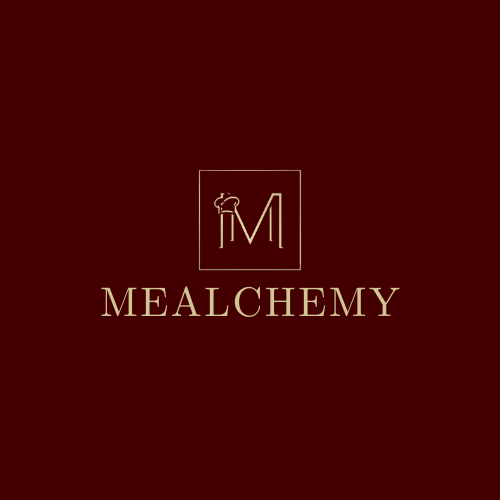
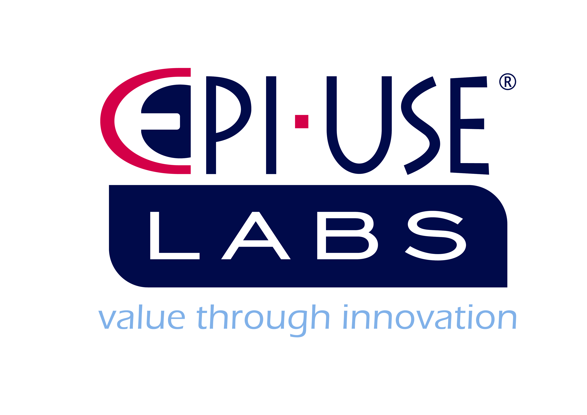
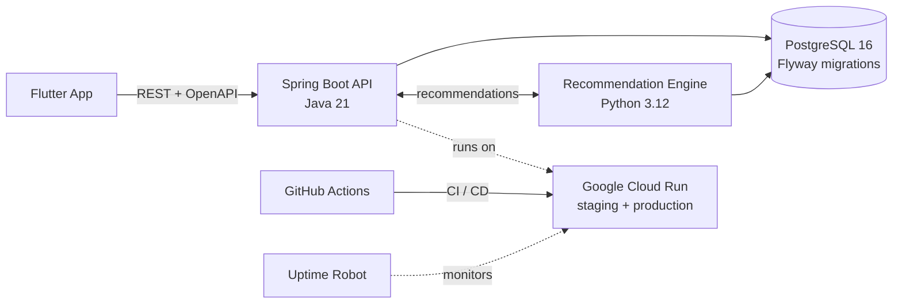

<div align="center">




# Mealchemy

**Turn what's in your pantry into what's on your plate.**

An intelligent recipe management and discovery ecosystem, built by Team PUL5E.

[](https://youtu.be/P83dsDzIkEM)
[](https://appdistribution.firebase.dev/i/3d354d60d11cde9b)
[](https://mealchemy-firebase.web.app/)
[](https://github.com/COS301-SE-2026/Mealchemy/wiki)

<br/>

[](https://codecov.io/gh/COS301-SE-2026/Mealchemy)
[](https://codecov.io/gh/COS301-SE-2026/Mealchemy)
[](https://codecov.io/gh/COS301-SE-2026/Mealchemy)
[](https://github.com/COS301-SE-2026/Mealchemy/actions/workflows/ci.yml)
[](https://github.com/COS301-SE-2026/Mealchemy/actions/workflows/cd.yml)
[](https://github.com/COS301-SE-2026/Mealchemy/actions/workflows/frontend-delivery.yml)
[](https://github.com/COS301-SE-2026/Mealchemy/actions/workflows/deploy-landing-page.yml)
[](https://github.com/COS301-SE-2026/Mealchemy/actions/workflows/deploy-design-spec.yml)
[](https://stats.uptimerobot.com/wnmHUXyJfN)
[](https://github.com/COS301-SE-2026/Mealchemy/issues)

<br/>

<h3>App Trailer</h3>

<a href="https://youtube.com/shorts/SEP7DQe_GJk">
  
</a>

<sub>▶ Click to watch the trailer on YouTube</sub>

</div>

---

## About

Mealchemy eliminates meal-time indecision by transforming your available ingredients into personalised, shoppable culinary experiences. It is both a **digital recipe vault** and an **intelligent discovery engine**, bridging the gap between what is in your pantry and what ends up on your plate.

| Before Mealchemy | With Mealchemy |
|:---|:---|
| "What can I make with what I have?" | Your pantry answers it, with a match % on every recipe |
| Recipes scattered across tabs, screenshots and notes | One organised vault, private or shared |
| Missing an ingredient halfway through cooking | Shopping lists built from what's missing |
| Generic suggestions | Recommendations tuned to your taste and dietary profile |

<br/>

## Features

- **Swipe discovery:** swipe through one recipe at a time, filter by Quick Meals, High Protein or Vegetarian, and see why each recipe matches you (pantry match, freshness, cuisine, nutritional goals). Recommendations adapt to your likes, dislikes and skips.
- **Sizzles:** short cooking videos you can swipe through, open as a full recipe, or save.
- **Personal profile:** dietary restrictions, allergies, disliked ingredients, flavour preferences, nutritional goals, cooking equipment and metric or imperial units shape every recommendation.
- **Recipe vault:** create your own recipes with photo or video, organise them in folders, save external links, and publish to the community vault.
- **Shared vaults:** collaborate with Owner, Editor and Viewer roles, email invitations, edit locking and an in-app notification inbox.
- **Pantry tracking:** an ingredient inventory with categories, search and freshness status.
- **Shopping lists:** generate lists from recipes or meal plans, add items manually, and push purchased items to your pantry. Smart add lists only what you do not already own.
- **Meal planning:** plan recipes by date and timeslot, get pantry-aware suggestions, and shop for a whole date range.
- **Hands-free cooking:** step-by-step cooking mode with read-aloud steps, voice commands ("next", "back", "repeat"), adjustable speed and multiple named timers.
- **Recipe detail and nutrition:** prep and cook time, adjustable servings, and calories, macros and per-ingredient nutrients, per recipe or per serving.
- **Community moderation:** report recipes in the community vault, with moderators reviewing, removing or dismissing flags.
- **Offline mode:** browse cached vaults, recipes, pantry, shopping lists and Discover content with a "last synced" indicator.

<br/> 

## Architecture




More detail: [Architectural Requirements](https://github.com/COS301-SE-2026/Mealchemy/wiki/Architectural-Requirements-Demo-4) · [Technology Requirements](https://github.com/COS301-SE-2026/Mealchemy/wiki/Technology-Requirements-Demo-4) · [Deployment](https://github.com/COS301-SE-2026/Mealchemy/wiki/Deployment-Demo-4) · [API Contracts](https://github.com/COS301-SE-2026/Mealchemy/wiki/API-Service-Contracts-Demo-4)

<br/>

## Quality and testing

| Practice | Where to look |
|:---|:---|
| CI/CD with separate CI, CD, frontend-delivery, landing-page and design-spec workflows | [`.github/workflows`](.github/workflows) |
| Code coverage split into backend and frontend flags | [`Codecov`](https://codecov.io/gh/COS301-SE-2026/Mealchemy) |
| Static analysis | [`sonar-project.properties`](sonar-project.properties) |
| Performance and resilience: k6 load, resilience and comparison tests | [`nfr-tests/performance`](nfr-tests/performance) |
| Security: authorization matrix and OWASP ZAP tooling | [`nfr-tests/security`](nfr-tests/security) |
| End-to-end mobile flows with Maestro | [`e2e/`](e2e) |
| Live production uptime monitoring | [`Status page`](https://stats.uptimerobot.com/wnmHUXyJfN) |

<br/>

## Quick Links

| Resource | Link |
|:---|:---|
| Demo video | [Watch](https://youtu.be/P83dsDzIkEM) |
| GitHub Project Board | [Project Board](https://github.com/orgs/COS301-SE-2026/projects/67) |
| Wiki (all documentation) | [Wiki Home](https://github.com/COS301-SE-2026/Mealchemy/wiki) |
| Backend (production) | [mealchemy-backend-prod](https://mealchemy-backend-prod-otygypdv7a-ey.a.run.app) |
| Backend (staging) | [mealchemy-backend-staging](https://mealchemy-backend-staging-otygypdv7a-ey.a.run.app) |
| Uptime status page | [Production monitor](https://stats.uptimerobot.com/wnmHUXyJfN) |
| Landing page | [mealchemy-firebase.web.app](https://mealchemy-firebase.web.app/) |
| Android app | [Download](https://appdistribution.firebase.dev/i/3d354d60d11cde9b) |
| Brand style guide | [Brand Guide](https://cos301-se-2026.github.io/Mealchemy/) |
| Service contracts | [OpenAPI / Swagger](https://mealchemy-backend-staging-otygypdv7a-ey.a.run.app/swagger-ui/index.html#/vault-controller/getVault) |
| Team email | [pulsefive@gmail.com](mailto:pulsefive@gmail.com) |

<br/>

## Documentation

All documentation is contained within the [Wiki](https://github.com/COS301-SE-2026/Mealchemy/wiki).

<details>
  <summary>Demo 4 (latest) - Click to expand</summary>

### Software Requirements Specifications (SRS)

| Page | Description |
|------|-------------|
| [Introduction](https://github.com/COS301-SE-2026/Mealchemy/wiki/SRS-Introduction-Demo-4) | Project background, motivation, and scope |
| [User Stories](https://github.com/COS301-SE-2026/Mealchemy/wiki/User-Stories-and-Characteristics-Demo-4) | Intended users and how they interact with the system |
| [Use Cases](https://github.com/COS301-SE-2026/Mealchemy/wiki/Use-Cases-Demo-4) | High-level use case diagrams and descriptions |
| [Functional Requirements](https://github.com/COS301-SE-2026/Mealchemy/wiki/Functional-Requirements-Demo-4) | Feature breakdown by subsystem |
| [Non-Functional Requirements](https://github.com/COS301-SE-2026/Mealchemy/wiki/Non‐Functional-Requirements-Demo-4) | Feature breakdown by subsystem |
| [Domain Model](https://github.com/COS301-SE-2026/Mealchemy/wiki/Domain-Model-Demo-4) | UML class diagram |

### Software Architecture Specifications (SAS)

| Page | Description |
|------|-------------|
| [Introduction](https://github.com/COS301-SE-2026/Mealchemy/wiki/SAS-Introduction-Demo-4) | Project background, motivation, and scope |
| [Architectural Requirements](https://github.com/COS301-SE-2026/Mealchemy/wiki/Architectural-Requirements-Demo-4) | Intended users and how they interact with the system |
| [Technology Requirements](https://github.com/COS301-SE-2026/Mealchemy/wiki/Technology-Requirements-Demo-4) | Technology Requirements |
| [API Service Contracts](https://mealchemy-backend-staging-otygypdv7a-ey.a.run.app/swagger-ui/index.html#/vault-controller/getVault) | API Contracts - OpenAPI Swagger Schema |
| [Deployment](https://github.com/COS301-SE-2026/Mealchemy/wiki/Deployment-Demo-4) | Deployment |

### Other Documents

| Page | Description |
|------|-------------|
| [Coding Standards Document](https://github.com/COS301-SE-2026/Mealchemy/wiki/Coding-Standards-Document-Demo-4) | Code style conventions and repository structure guidelines |
| [User Manual](https://github.com/COS301-SE-2026/Mealchemy/wiki/User-Manual-Document-Demo-4) | How to use the app - screenshots and feature walkthroughs |
| [Testing Policy Document](https://github.com/COS301-SE-2026/Mealchemy/wiki/Testing-Policy-Document-Demo-4) | Testing standards, types, tools, and responsibilities |
| [Changelog](https://github.com/COS301-SE-2026/Mealchemy/wiki/Changelog-Demo-4) | Version history and what changed each demo |

</details>

<details>
  <summary>Demo 3 - Click to expand</summary>

### Software Requirements Specifications (SRS)

| Page | Description |
|------|-------------|
| [Introduction](https://github.com/COS301-SE-2026/Mealchemy/wiki/SRS-Introduction-Demo-3) | Project background, motivation, and scope |
| [User Stories](https://github.com/COS301-SE-2026/Mealchemy/wiki/User-Stories-and-Characteristics-Demo-3) | Intended users and how they interact with the system |
| [Use Cases](https://github.com/COS301-SE-2026/Mealchemy/wiki/Use-Cases-Demo-3) | High-level use case diagrams and descriptions |
| [Functional Requirements](https://github.com/COS301-SE-2026/Mealchemy/wiki/Functional-Requirements-Demo-3) | Feature breakdown by subsystem |
| [Non-Functional Requirements](https://github.com/COS301-SE-2026/Mealchemy/wiki/Non‐Functional-Requirements-Demo-3) | Feature breakdown by subsystem |
| [Domain Model](https://github.com/COS301-SE-2026/Mealchemy/wiki/Domain-Model-Demo-3) | UML class diagram |


### Software Architecture Specifications (SAS)

| Page | Description |
|------|-------------|
| [Introduction](https://github.com/COS301-SE-2026/Mealchemy/wiki/SAS-Introduction-Demo-3) | Project background, motivation, and scope |
| [Architectural Requirements](https://github.com/COS301-SE-2026/Mealchemy/wiki/Architectural-Requirements-Demo-3) | Intended users and how they interact with the system |
| [Technology Requirements](https://github.com/COS301-SE-2026/Mealchemy/wiki/Technology-Requirements-Demo-3) | Technology Requirements |
| [API Service Contracts](https://github.com/COS301-SE-2026/Mealchemy/wiki/API-Service-Contracts-Demo-3) | API Contracts |
| [Deployment](https://github.com/COS301-SE-2026/Mealchemy/wiki/Deployment-Demo-3) | Deployment |

### Other Documents

| Page | Description |
|------|-------------|
| [Coding Standards Document](https://github.com/COS301-SE-2026/Mealchemy/wiki/Coding-Standards-Document-Demo-3) | Code style conventions and repository structure guidelines |
| [User Manual](https://github.com/COS301-SE-2026/Mealchemy/wiki/User-Manual-Document-Demo-3) | How to use the app - screenshots and feature walkthroughs |
| [Testing Policy Document](https://github.com/COS301-SE-2026/Mealchemy/wiki/Testing-Policy-Document-Demo-3) | Testing standards, types, tools, and responsibilities |
| [Changelog](https://github.com/COS301-SE-2026/Mealchemy/wiki/Changelog-Demo-3) | Version history and what changed each demo |

</details>


<details>
  <summary>Demo 2 - Click to expand</summary>

### Software Requirements Specifications (SRS)

| Page | Description |
|------|-------------|
| [Introduction](https://github.com/COS301-SE-2026/Mealchemy/wiki/SRS-Introduction-Demo-2) | Project background, motivation, and scope |
| [User Stories](https://github.com/COS301-SE-2026/Mealchemy/wiki/User-Stories-and-Characteristics-Demo-2) | Intended users and how they interact with the system |
| [Use Cases](https://github.com/COS301-SE-2026/Mealchemy/wiki/Use-Cases-Demo-2) | High-level use case diagrams and descriptions |
| [Functional Requirements](https://github.com/COS301-SE-2026/Mealchemy/wiki/Functional-Requirements-Demo-2) | Feature breakdown by subsystem |
| [Non-Functional Requirements](https://github.com/COS301-SE-2026/Mealchemy/wiki/Non‐Functional-Requirements-Demo-2) | Feature breakdown by subsystem |
| [Domain Model](https://github.com/COS301-SE-2026/Mealchemy/wiki/Domain-Model-Demo-2) | UML class diagram |

### Software Architecture Specifications (SAS)

| Page | Description |
|------|-------------|
| [Introduction](https://github.com/COS301-SE-2026/Mealchemy/wiki/SAS-Introduction-Demo-2) | Project background, motivation, and scope |
| [Architectural Requirements](https://github.com/COS301-SE-2026/Mealchemy/wiki/Architectural-Requirements-Demo-2) | Intended users and how they interact with the system |
| [Technology Requirements](https://github.com/COS301-SE-2026/Mealchemy/wiki/Technology-Requirements-Demo-2) | Technology Requirements |
| [API Service Contracts](https://github.com/COS301-SE-2026/Mealchemy/wiki/API-Service-Contracts-Demo-2) | API Contracts |
| [Deployment](https://github.com/COS301-SE-2026/Mealchemy/wiki/Deployment-Demo-2) | Deployment |

### Other Documents

| Page | Description |
|------|-------------|
| [Coding Standards Document](https://github.com/COS301-SE-2026/Mealchemy/wiki/Coding-Standards-Document-Demo-2) | Code style conventions and repository structure guidelines |
| [User Manual](https://github.com/COS301-SE-2026/Mealchemy/wiki/User-Manual-Document-Demo-2) | How to use the app - screenshots and feature walkthroughs |
| [Testing Policy Document](https://github.com/COS301-SE-2026/Mealchemy/wiki/Testing-Policy-Document-Demo-2) | Testing standards, types, tools, and responsibilities |
| [Changelog](https://github.com/COS301-SE-2026/Mealchemy/wiki/Changelog-Demo-2) | Version history and what changed each demo |

</details>

<details>
 <summary>Demo 1 - Click to expand</summary>

| Page | Description |
|------|-------------|
| [Introduction](https://github.com/COS301-SE-2026/Mealchemy/wiki/Introduction-Demo-1) | Project background, motivation, and scope |
| [User Stories](https://github.com/COS301-SE-2026/Mealchemy/wiki/User-Stories-User-Characteristics-Demo-1) | Intended users and how they interact with the system |
| [Use Cases](https://github.com/COS301-SE-2026/Mealchemy/wiki/Uses-Cases-Demo-1) | High-level use case diagrams and descriptions |
| [Functional Requirements](https://github.com/COS301-SE-2026/Mealchemy/wiki/Functional-Requirements-Demo-1) | Feature breakdown by subsystem |
| [API Service Contracts](https://github.com/COS301-SE-2026/Mealchemy/wiki/API-Service-Contracts-Demo-1) | API Contracts |
| [Domain Model](https://github.com/COS301-SE-2026/Mealchemy/wiki/Domain-model-Demo-1) | UML class diagram |
| [Quality Requirements](https://github.com/COS301-SE-2026/Mealchemy/wiki/Quality-Requirements-Demo-1) | Performance, security, scalability targets |
| [Architectural Patterns](https://github.com/COS301-SE-2026/Mealchemy/wiki/Architectural-Patterns-Demo-1) | Design and architectural pattern decisions |
| [Design Patterns](https://github.com/COS301-SE-2026/Mealchemy/wiki/Design-Patterns-Demo-1) | Design and architectural pattern decisions |
| [Architectural Constraints](https://github.com/COS301-SE-2026/Mealchemy/wiki/Architectural-Constraints-Demo-1) | Architectural Constraints |
| [Architectural Diagram](https://github.com/COS301-SE-2026/Mealchemy/wiki/Architectural-Diagram-Demo-1) | System architecture and component overview |
| [Technology Requirements](https://github.com/COS301-SE-2026/Mealchemy/wiki/Technology-Requirements-Demo-1) | Technology Requirements |

</details>

<br/>

</details>

## Getting started

**Prerequisites:** Docker Desktop · Java 21 · Flutter (stable) · Python 3.12

```bash
# Clone with the wiki submodule
git clone --recurse-submodules https://github.com/COS301-SE-2026/Mealchemy.git
cd Mealchemy

# Set up environment, then fill in your credentials in .env
cp .env.example .env

# Start Postgres and backend
docker compose -f infrastructure/docker-compose.yml --env-file .env up --build
```

Verify the backend is up:

```bash
curl http://localhost:8080/actuator/health
# -> {"status":"UP"}
```

<details>
<summary><b>Repository structure</b></summary>

<br/>

Mealchemy is a monorepo under the `COS301-SE-2026` organisation.

```
Mealchemy/
├── .github/
│   ├── workflows/             ← CI, CD, rollback, documentation, and delivery workflows
│   ├── codecov.yml            ← Codecov coverage thresholds and flags
│   └── labeler.yml            ← Pull-request auto-label rules
├── backend/                   ← Spring Boot Java 21 REST API
├── database/                  ← Versioned Flyway SQL migrations
├── design-spec/               ← Brand guide and wireframes deployed to GitHub Pages
├── diagrams/                  ← Architecture and deployment diagram files
├── docs/                      ← Local setup and deployment guides
├── e2e/                       ← Maestro end-to-end mobile tests
├── engine/                    ← Python 3.12 recommendation engine
├── frontend/                  ← Flutter mobile application
├── infrastructure/            ← Dockerfiles, Docker Compose, and cloud provisioning
├── landing-page/              ← Static landing page deployed to Firebase Hosting
├── nfr-tests/                 ← Executable non-functional test harness
│   ├── config/                ← Shared k6 environment and sanitized-summary helpers
│   ├── performance/           ← k6 load, resilience, and comparison tests
│   ├── results/               ← Sanitized NFR evidence files
│   └── security/              ← Authorization matrix and ZAP security tooling
├── wiki/                      ← Git submodule containing project documentation
├── .env.example               ← Template for local Docker configuration
├── .secrets.example           ← Template for local act CI secrets
├── firebase.json              ← Firebase Hosting deployment configuration
├── sonar-project.properties   ← SonarCloud analysis configuration
└── README.md
```

</details>

<details>
<summary><b>Branching strategy</b></summary>

<br/>

```text
main
 └── dev
      └── UseCase/{UseCase Name}
               └── feat/UC{n}-{description}/teamMember
```

| Branch | Purpose |
|:---|:---|
| `main` | Production-ready, always working. Protected, team lead merges only |
| `dev` | Integration branch, all completed work lands here first |
| `UseCase/{UseCase Name}` | One full use case end-to-end across backend, frontend and database |
| `feat/{UseCase}-{description}/TeamMember` | A sub-task within a use case, small and reviewable |
| `fix/{description}` | Bug fixes, merged into dev |
| `docs/{description}` | Documentation only, merged into dev |

</details>

<br/>

## Team

<div align="center">
  
</div>

<br/>

<table>
  <tr>
    <td align="center" width="170" valign="middle">
      
    </td>
    <td valign="middle">
      <b>Gabriela Berimbau</b> - Team Lead & Backend Developer<br/>
      <br/>
      <i>"Adaptable, organised and dependable: I lead with communication and build lasting connections."</i><br/>
      <sub>Theoretical computer science · Leadership</sub><br/>
      <br/>
      <a href="https://www.linkedin.com/in/gabriela-berimbau-b19866254">LinkedIn</a> · <a href="https://github.com/GabrielaBerimbau">GitHub</a> · <a href="mailto:giberimbau@gmail.com">Email</a>
    </td>
  </tr>
  <tr>
    <td align="center" width="170" valign="middle">
      
    </td>
    <td valign="middle">
      <b>Megan Azmanov</b> - DevOps Lead & Full-Stack Developer<br/>
      <br/>
      <i>"A systems thinker who pairs analytical rigour with a creative edge."</i><br/>
      <sub>System integration · CI/CD · Containerisation</sub><br/>
      <br/>
      <a href="http://www.linkedin.com/in/megan-azmanov-409a983a8">LinkedIn</a> · <a href="https://github.com/Megan235">GitHub</a> · <a href="mailto:meganazmanov@gmail.com">Email</a>
    </td>
  </tr>
  <tr>
    <td align="center" width="170" valign="middle">
      
    </td>
    <td valign="middle">
      <b>Sofia Finlayson</b> - Frontend Developer & Integration<br/>
      <br/>
      <i>"Detail-oriented and reliable, I make every component talk to the next seamlessly."</i><br/>
      <sub>Frontend &amp; backend · User-focused solutions</sub><br/>
      <br/>
      <a href="https://www.linkedin.com/in/sofia-finlayson-a751b61b4/">LinkedIn</a> · <a href="https://github.com/sofiafinlayson">GitHub</a> · <a href="mailto:finlaysonsofia@gmail.com">Email</a>
    </td>
  </tr>
  <tr>
    <td align="center" width="170" valign="middle">
      
    </td>
    <td valign="middle">
      <b>Paul Hofmeyr</b> - Backend Developer & Recommendation Engine Architect<br/>
      <br/>
      <i>"Curious about how systems really work, from the fundamentals up."</i><br/>
      <sub>Cybersecurity · Self-directed learning</sub><br/>
      <br/>
      <a href="https://www.linkedin.com/in/paul-hofmeyr-a0b567308">LinkedIn</a> · <a href="https://github.com/PaulHofmeyr">GitHub</a> · <a href="mailto:psmhofmeyr@gmail.com">Email</a>
    </td>
  </tr>
  <tr>
    <td align="center" width="170" valign="middle">
      
    </td>
    <td valign="middle">
      <b>Mutombo Kabau</b> - Frontend Developer & Integration<br/>
      <br/>
      <i>"Driven to sharpen my craft, in the team and on personal projects."</i><br/>
      <sub>Frontend development · Frontend–backend integration</sub><br/>
      <br/>
      <a href="https://www.linkedin.com/in/mutombo-kabau-113091222">LinkedIn</a> · <a href="https://github.com/u24957102">GitHub</a> · <a href="mailto:kabau8605@gmail.com">Email</a>
    </td>
  </tr>
</table>

---

<div align="center">
  <sub>Built by <b>Team PUL5E</b> · COS301 Software Engineering · University of Pretoria · <a href="mailto:pulsefive@gmail.com">pulsefive@gmail.com</a></sub>
</div>
